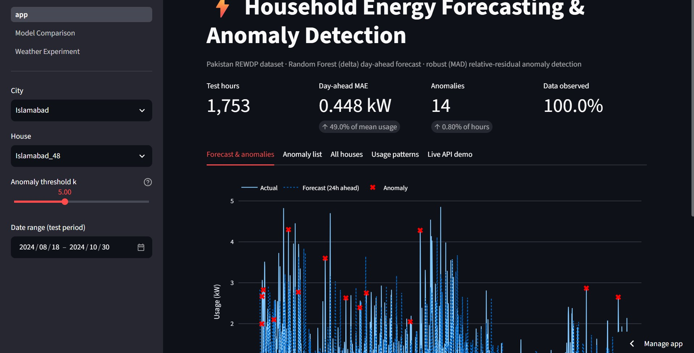
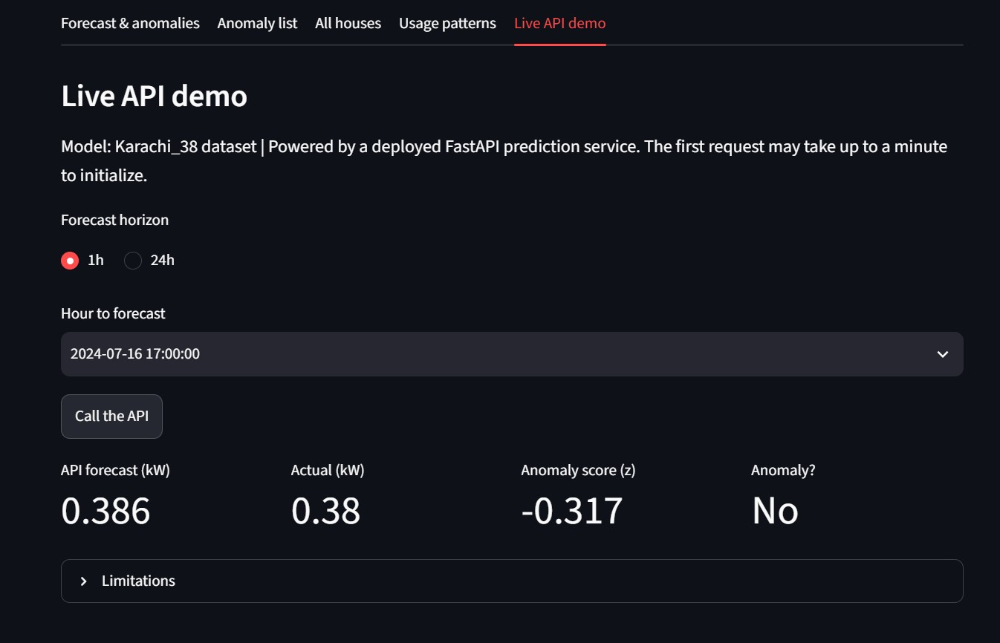
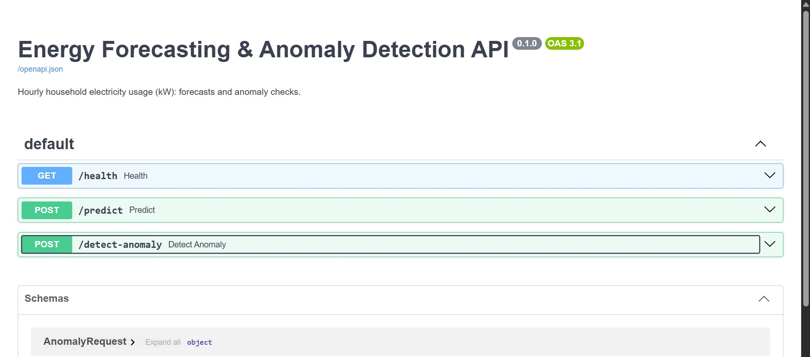
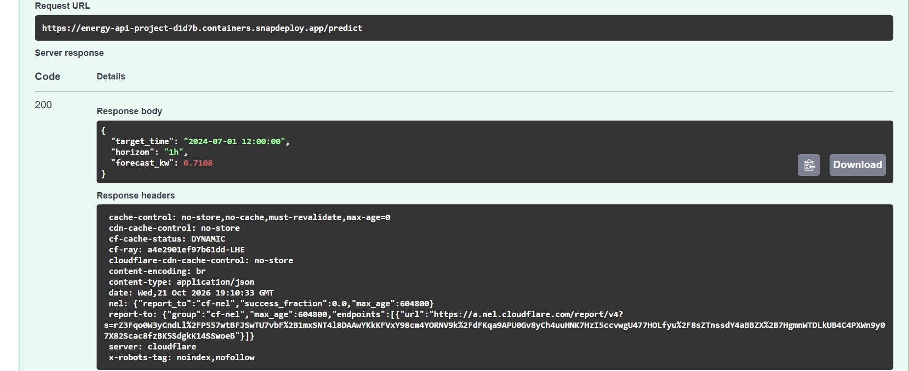
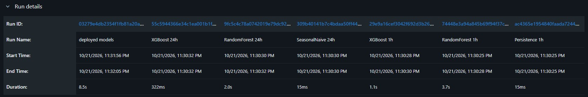

# ⚡ AI-Powered Energy Consumption Forecasting & Anomaly Detection System

An end-to-end project that cleans household smart-meter data, forecasts electricity usage, flags unusual consumption, and serves the results through an interactive dashboard and a prediction API.

- [Live dashboard](https://household-energy-forecasting-and-anomaly-detection.streamlit.app)
- [Prediction API (Swagger docs)](https://energy-api-project-d1d7b.containers.snapdeploy.app/docs)

## Data

REWDP (Residential Energy and Weather Data, Pakistan): minute-level smart-meter readings for 18 houses in 6 cities (Karachi, Lahore, Peshawar, Multan, Skardu, Islamabad), about one year (Sept 2023 – Aug 2024), plus an hourly weather dataset for the same cities.

The full dataset covers about 60 houses, each with 500k+ minute-level rows. Because of the heavy compute and memory load, 3 houses were selected from each city (18 houses in total) for modelling and evaluation.

[Resourse_of_data](https://lei.lums.edu.pk/datasets/residential-energy-and-weather-data-pakistan.html)

## What the system does

1. **Data cleaning & EDA** – repairs repeated timestamps, treats long runs of zeros as sensor downtime, resamples to hourly values, keeps an `observed` flag so filled hours are never used as targets, and explores daily, weekly and seasonal patterns.
2. **Forecasting** – Random Forest models for **1 hour ahead** and **day ahead**. Features: hour, weekday, weekend flag, lags (1, 2, 24, 48, 168 h) and rolling statistics computed from past hours only (no leakage). The model predicts the *change* from a base lag (delta target). Compared against persistence and seasonal-naive baselines, plus XGBoost, LightGBM, HistGradientBoosting, Ridge and an LSTM.
3. **Anomaly detection** – relative forecast residual with a robust (median/MAD) z-score. The threshold is calibrated on a **validation** period, not on the test set. Sensitivity `k` (default 5) is adjustable in the dashboard. Isolation Forest is used as a cross-check.
4. **Weather experiment** – tested with and without weather on validation and test; not used in the final model (see results).
5. **Dashboard (Streamlit)** – city/house/date selection, actual vs forecast, detected anomalies with a sensitivity slider, anomaly list, all-house comparison, usage patterns, and a live call to the API.
6. **API (FastAPI)** – `/health`, `/predict` (1 h or 24 h ahead) and `/detect-anomaly`.
7. **Experiment tracking (MLflow)** – baselines, Random Forest and XGBoost for both horizons are logged with parameters, metrics and the deployed model files, so all runs can be compared in one table.

## Screenshots

**Dashboard – forecast and anomalies**


**Dashboard – live API demo**


**API documentation (Swagger)**


**API prediction response**


**MLflow – run comparison (baselines, Random Forest, XGBoost, 1 h and 24 h)**


## Results (test period = last 20% of each house's data, chronological split 70/10/20)

| City | nMAE day-ahead | Skill vs persistence (1 h) | Skill vs seasonal naive (day-ahead) | Anomaly rate (k = 5) |
|---|---|---|---|---|
| Multan | 0.336 | 0.081 | 0.082 | 2.1 % |
| Lahore | 0.390 | 0.062 | 0.117 | 1.4 % |
| Karachi | 0.424 | 0.013 | 0.074 | 0.7 % |
| Islamabad | 0.476 | 0.036 | 0.022 | 1.0 % |
| Peshawar | 0.505 | 0.090 | −0.038 | 1.9 % |
| Skardu | 0.939 | −0.155 | 0.070 | 6.1 % |

*nMAE = MAE divided by the house's mean usage. Skill = 1 − MAE_model / MAE_baseline (0 = no better than the baseline, negative = worse).*

Key findings:
- The delta Random Forest beats the seasonal-naive baseline for the day-ahead forecast in **13 of 18 houses** (average skill about 5 %); gains are modest.
- At 1 hour ahead, **persistence is very hard to beat** (the model is better in 13 of 18 houses, by small margins).
- Delta targets clearly outperform predicting the raw level; the LSTM did not beat the Random Forest.
- **Weather** helped on both validation and test in only 7 of 18 houses and hurt others (up to −19 % in Karachi); choosing weather per house by validation gain gave a mean test change of about −0.65 %. It is therefore excluded from the final model.
- Skardu is the hardest city (spiky usage, high nMAE and anomaly rate).

## Limitations

- About one year of data per house; the test window is short and season-specific (mostly the school summer vacation, while training is mostly school term).
- The detector finds point anomalies, not sustained level shifts (e.g. a house whose load drops ~80 % for weeks).
- Anomalies are statistical outliers, not confirmed faults. Holidays such as Eid can look like anomalies.
- Weather was tested with *observed* data; a real deployment would only have forecasts.
- The deployed API serves the models of one house (Karachi_38) as a showcase.

## Future work

Live smart-meter integration: connect real meters (or an IoT gateway) so the API receives readings in real time, forecasts the next hours and raises anomaly alerts automatically.
Extend the system to all ~60 houses with scalable (batch or distributed) processing.
multi-year data with calendar features (school terms, Ramadan, Eid, public holidays), change-point detection (e.g. CUSUM), rolling cross-validation, model monitoring and scheduled retraining, forecast-weather inputs.

## Repository structure

```
app.py                 Streamlit dashboard (main page)
pages/                 extra dashboard pages
artifacts/             per-house predictions, z-scores and meta.json used by the dashboard
requirements.txt       dashboard dependencies
notebooks/             00 raw exploration, 01 cleaning & EDA, 02 features & baselines,
                       03 LSTM, 04 anomaly detection, 05 multi-city study,
                       06 model export, 07 weather experiment, 08 MLflow experiment tracking
```
The API lives in its own [repository](https://github.com/Baloxh-Aziz/energy-api-project) .

## Run locally

Dashboard:
```bash
pip install -r requirements.txt
streamlit run app.py
```

API:
```bash
pip install -r requirements.txt
uvicorn main:app --reload      # then open http://127.0.0.1:8000/docs
```


## Tech stack

Python, Pandas, NumPy, Matplotlib, Scikit-learn, XGBoost, LightGBM, TensorFlow/Keras, MLflow, FastAPI, Streamlit, Plotly, GitHub.


## Group Member
`Azizullah Asad & Muhammad Yahya`
Built as the final project of the SMIT course.
